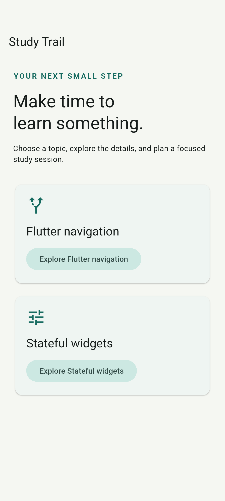
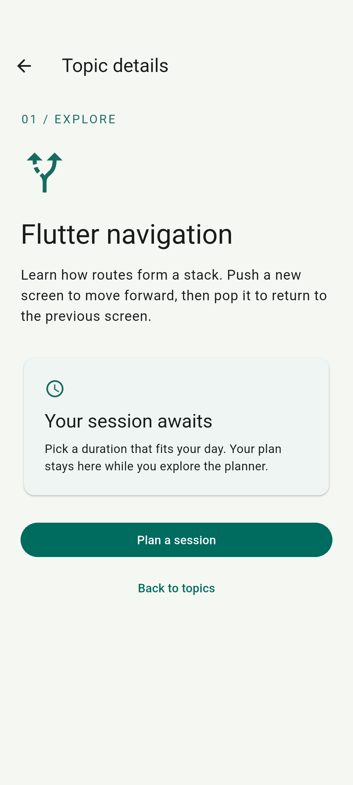
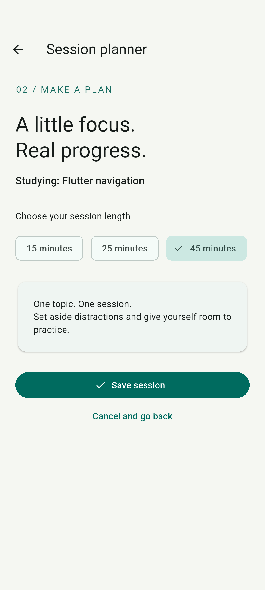
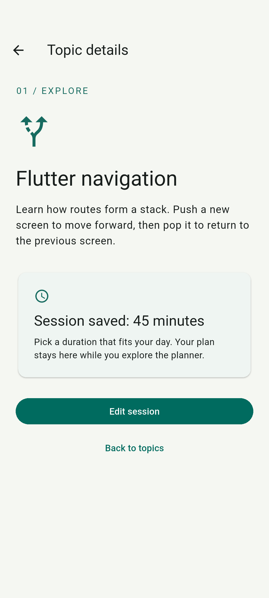

# Mobile App Development

ITS-537-M50: Info Tech & Mobile Application.

## Hello World assignment

- App source: `hello_world/lib/main.dart`
- Setup description: `hello_world/submission/Hello_World_Description.pdf`
- Emulator screenshots: `hello_world/submission/screenshots/`

With Flutter and an Android emulator installed, run from `hello_world`:

```sh
flutter pub get
flutter run
```

The Android scaffold was generated by Flutter. The app screen and description were prepared for this assignment with AI assistance; screenshots were captured from the running Android emulator. Setup follows the [official Flutter documentation](https://docs.flutter.dev/install).

## Mobile App Lab – UI Design in Flutter

The app contains two screens. `HomeScreen` extends `StatelessWidget` because its welcome content does not require changing local state. `Scaffold` and `AppBar` provide the screen structure, while `Column`, `Icon`, `Text`, and `SizedBox` arrange the content and spacing. A `FilledButton` opens `CounterScreen` using `Navigator` and `MaterialPageRoute`. The second screen’s app bar provides a back button to return home.

`CounterScreen` extends `StatefulWidget` and stores an integer counter in its associated `State` object. Pressing **Add one** increments the counter inside `setState()`, which tells Flutter to rebuild the screen with the updated number and message. Pressing **Reset** sets the counter to zero and restores the initial message. The value is stored only while that screen remains open; reopening it starts at zero. Navigation, incrementing, and resetting were verified on an Android emulator and through an automated widget test.

- [App source](ui_design_lab/lib/main.dart)
- [Run instructions](ui_design_lab/README.md)
- [Home screenshot](ui_design_lab/submission/screenshots/01_home.png)
- [Initial counter screenshot](ui_design_lab/submission/screenshots/02_counter_initial.png)
- [Updated counter screenshot](ui_design_lab/submission/screenshots/03_counter_updated.png)

## Gesture-Controlled Interface

This app uses a large gesture card: tapping changes its color, horizontal swipes report direction and update a count, and a long press resets the interaction. The animated color feedback and status message make each action visible.

- [App source](gesture_controlled_interface/lib/main.dart)
- [Run instructions](gesture_controlled_interface/README.md)
- [Initial screen](gesture_controlled_interface/submission/screenshots/01-initial.png)
- [Tap result](gesture_controlled_interface/submission/screenshots/02-tap.png)
- [Swipe result](gesture_controlled_interface/submission/screenshots/03-swipe.png)
- [Long-press reset](gesture_controlled_interface/submission/screenshots/04-long-press.png)
- [300–400 word reflection](gesture_controlled_interface/submission/reflection.txt)

The gestures were checked on an Android emulator and in Chrome on macOS. A native macOS build is also scaffolded; it requires Xcode.

## Multi-Screen Navigation in Flutter

Study Trail contains three screens: Home, Topic Details, and Session Planner. Users explore a topic, choose a study duration, and return to the existing Details screen with their saved selection. Navigation uses `Navigator.push`, `Navigator.pop`, and typed route results. Canceling preserves any previously saved duration.

- [App source](multi_screen_navigation/lib/main.dart)
- [Run instructions](multi_screen_navigation/README.md)
- [348-word reflection and APA references](multi_screen_navigation/submission/reflection.md)
- [Testing and navigation issue reproduction](multi_screen_navigation/submission/testing.md)
- [Home screenshot](multi_screen_navigation/submission/screenshots/01_home.png)
- [Topic Details screenshot](multi_screen_navigation/submission/screenshots/02_details.png)
- [Session Planner screenshot](multi_screen_navigation/submission/screenshots/03_planner.png)
- [Returned result screenshot](multi_screen_navigation/submission/screenshots/04_returned_result.png)

Static analysis, widget tests, and Android emulator integration tests passed. The troubleshooting report explicitly identifies the cancel-result bug as a controlled regression. The app and reflection were prepared with AI assistance; screenshots were captured from the running Android emulator.

### Submission

[Flutter project on GitHub](https://github.com/vkreator6/mobile_app_development/tree/main/multi_screen_navigation)

The project link above is the submission option for this assignment. It includes the complete Flutter source, platform scaffolding, tests, reflection, and screenshots.

### Reflection (348 words)

Study Trail is a small Flutter application that helps users choose a learning topic and plan a study session. It contains three distinct screens: Home, Topic Details, and Session Planner. The navigation structure uses Flutter’s Navigator and MaterialPageRoute. Each forward action pushes a route onto the stack, and each backward action pops the current route. This structure keeps the previous screen available underneath the active screen and follows Flutter’s documented approach to basic navigation (Flutter, n.d.-a).

Users begin on Home, where clearly labeled Explore buttons open the details for either Flutter navigation or stateful widgets. The selected StudyTopic object is passed through the Details screen’s constructor. On that screen, the user can read a short description and select Plan a session. The planner receives the topic and the current duration, so its heading identifies the correct topic and its selection reflects any saved plan. Users choose 15, 25, or 45 minutes and press Save session to return to Details.

Saving demonstrates data traveling backward through the navigation stack. Navigator.pop returns an integer, and the Details screen awaits that result before displaying the saved duration. Cancel and the app-bar back arrow return without saving. The explicit Back to topics button removes Details and reveals Home. These labels make the available actions understandable without requiring users to know how routing works.

During troubleshooting, a controlled regression reproduced a navigation-result issue: allowing a canceled planner route’s null result to overwrite the saved duration erased the previous plan. The test saved 45 minutes, reopened the planner, selected 15 minutes, and canceled. Without the null guard, the expected 45-minute confirmation disappeared. The corrected handler ignores null results and checks mounted before updating state, consistent with Flutter’s guidance on returning route data (Flutter, n.d.-b).

Validation included automated widget tests and an integration run on an Android emulator. The tests exercised both topics, saving, canceling, app-bar back navigation, and returning to the root. Screenshots record Home, Details, Planner, and the returned result. This exercise reinforced that reliable navigation involves both managing the route stack and deciding precisely when returned data should change existing screen state.

### Navigation screenshots

These screenshots were captured from the running Android emulator. Follow them in order to see forward navigation and the returned session duration.

| 1. Home — choose a topic | 2. Topic Details — plan a session |
| --- | --- |
|  |  |

| 3. Session Planner — select 45 minutes | 4. Details — returned result |
| --- | --- |
|  |  |

### Testing and troubleshooting

Static analysis, widget tests, and Android emulator integration tests passed. The cancel-result issue described in the reflection was deliberately reproduced in a controlled regression; the delivered handler preserves saved data when a route returns null. See the [testing report](multi_screen_navigation/submission/testing.md) for reproduction steps and results.

### References (APA 7th edition)

Flutter. (n.d.-a). *Navigate to a new screen and back*. https://docs.flutter.dev/cookbook/navigation/navigation-basics

Flutter. (n.d.-b). *Return data from a screen*. https://docs.flutter.dev/cookbook/navigation/returning-data

The reflection cites official Flutter documentation. Chapter 6 course materials were not supplied and are not cited.
