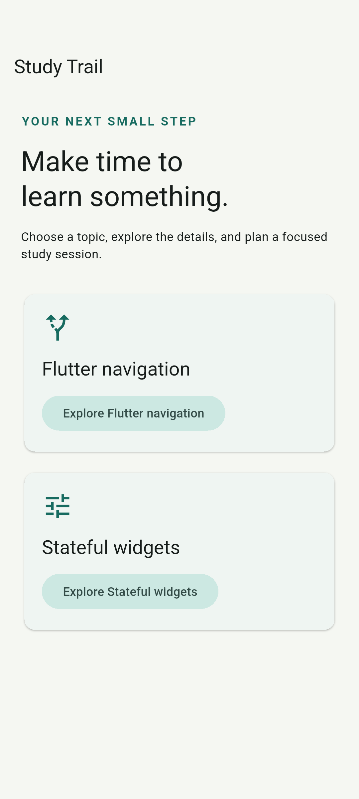
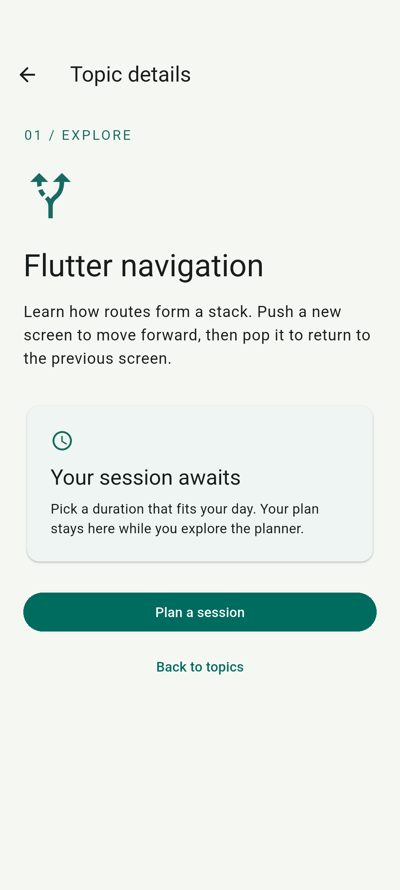
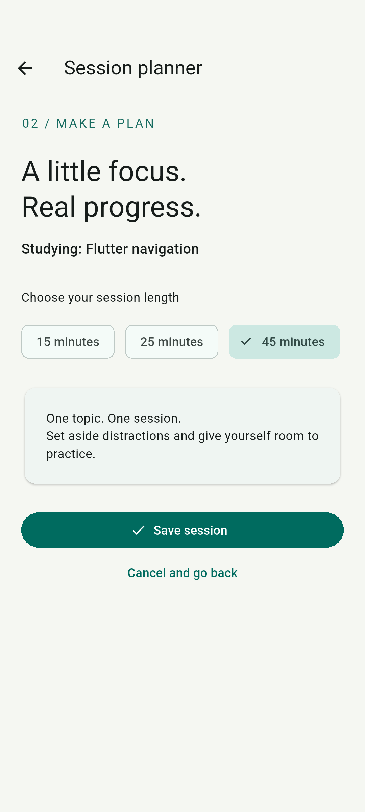
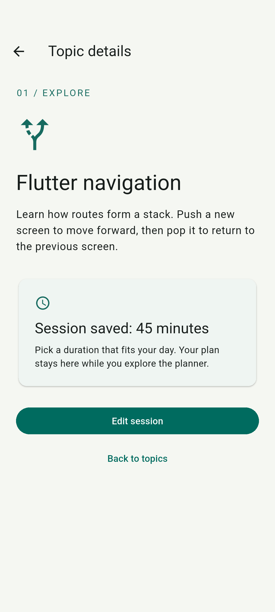

# Study Trail — Multi-Screen Navigation Lab

A Flutter app with three screens and typed route results. No backend or account is required.

## Run

With Flutter installed and an Android emulator or phone connected:

```sh
flutter pub get
flutter run
```

Select the Android device if prompted. Source for all three screens is in `lib/main.dart`.

## Navigation

```text
Home → Topic Details → Session Planner
Home ← Topic Details ← Session Planner (save returns minutes; cancel returns null)
```

Home pushes Details with a `StudyTopic` constructor argument. Details pushes Planner with the same topic and current duration. Planner saves with `Navigator.pop<int>(context, selectedMinutes)`. Details awaits the result and updates only when it is non-null and the widget remains mounted. App-bar back arrows and clearly labeled back/cancel buttons pop existing routes.

Session state is local to the Details route. It survives planner visits but is intentionally reset after leaving Details and opening a new topic; it is not persisted across app restarts.

## Validation

```sh
flutter analyze
flutter test
flutter drive --driver=test_driver/integration_test.dart --target=integration_test/navigation_test.dart -d emulator-5554
```

Replace `emulator-5554` with the ID reported by `flutter devices`. The integration driver saves actual emulator-rendered screenshots in `submission/screenshots/`.

The test covers both topics, forward data, all three duration choices, saving, explicit cancel, app-bar back, restoring the saved selection, and returning to the root without a duplicate route. See `submission/testing.md` for results and troubleshooting.

### Submission

[Flutter project on GitHub](https://github.com/vkreator6/mobile_app_development/tree/main/multi_screen_navigation)

The project link above is the submission option for this assignment. It includes the complete Flutter source, platform scaffolding, tests, reflection, and screenshots.

### Reflection (351 words)

Study Trail is a small Flutter application that helps users choose a learning topic and plan a study session. It contains three distinct screens: Home, Topic Details, and Session Planner. The navigation structure uses Flutter’s Navigator and MaterialPageRoute. Each forward action pushes a route onto the stack, and each backward action pops the current route. This structure keeps the previous screen available underneath the active screen and follows Flutter’s documented approach to basic navigation (Flutter, n.d.-b).

Users begin on Home, where clearly labeled Explore buttons open the details for either Flutter navigation or stateful widgets. The selected StudyTopic object is passed through the Details screen’s constructor. On that screen, the user can read a short description and select Plan a session. The planner receives the topic and the current duration, so its heading identifies the correct topic and its selection reflects any saved plan. Users choose 15, 25, or 45 minutes and press Save session to return to Details.

Saving demonstrates data traveling backward through the navigation stack. Navigator.pop returns an integer, and the Details screen awaits that result before displaying the saved duration (Flutter, n.d.-c). Cancel and the app-bar back arrow return without saving. The explicit Back to topics button removes Details and reveals Home. These labels make the available actions understandable without requiring users to know how routing works.

During troubleshooting, a controlled regression reproduced a navigation-result issue: allowing a canceled planner route’s null result to overwrite the saved duration erased the previous plan. The test saved 45 minutes, reopened the planner, selected 15 minutes, and canceled. Without the null guard, the expected 45-minute confirmation disappeared. The corrected handler ignores null results and checks mounted before updating state, consistent with Flutter’s guidance on returning route data (Flutter, n.d.-a, n.d.-d).

Validation included automated widget tests and an integration run on an Android emulator. The tests exercised both topics, saving, canceling, app-bar back navigation, and returning to the root. Screenshots record Home, Details, Planner, and the returned result. This exercise reinforced that reliable navigation involves both managing the route stack and deciding precisely when returned data should change existing screen state.

### Navigation screenshots

These screenshots were captured from the running Android emulator. Follow them in order to see forward navigation and the returned session duration.

| 1. Home — choose a topic | 2. Topic Details — plan a session |
| --- | --- |
|  |  |

| 3. Session Planner — select 45 minutes | 4. Details — returned result |
| --- | --- |
|  |  |

### Testing and troubleshooting

Static analysis, widget tests, and Android emulator integration tests passed. The cancel-result issue described in the reflection was deliberately reproduced in a controlled regression; the delivered handler preserves saved data when a route returns null. See the [testing report](submission/testing.md) for reproduction steps and results.

### References (APA 7th edition)

Flutter. (n.d.-a). *mounted property*. https://api.flutter.dev/flutter/widgets/State/mounted.html

Flutter. (n.d.-b). *Navigate to a new screen and back*. https://docs.flutter.dev/cookbook/navigation/navigation-basics

Flutter. (n.d.-c). *pop<T extends Object?> static method*. https://api.flutter.dev/flutter/widgets/Navigator/pop.html

Flutter. (n.d.-d). *Return data from a screen*. https://docs.flutter.dev/cookbook/navigation/returning-data

The reflection cites official Flutter documentation. Chapter 6 course materials were not supplied and are not cited.
